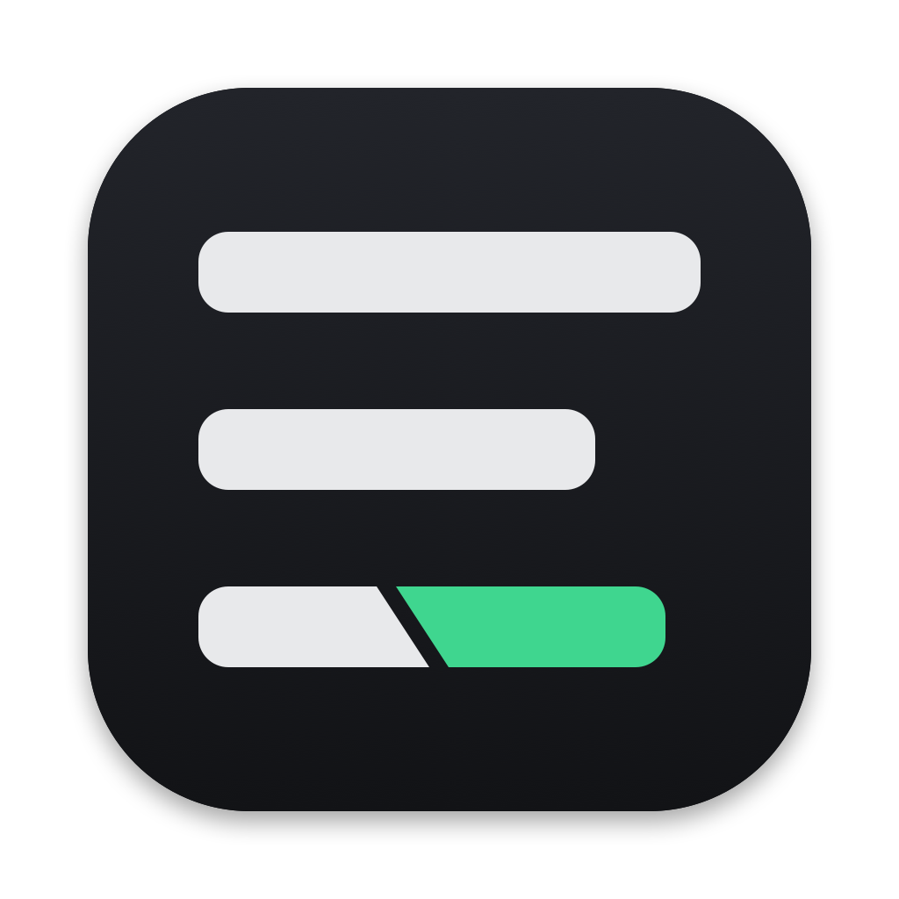

<p align="center"></p>

<h1 align="center">Folio</h1>

<p align="center"><b>Bare when installed, insanely customizable.</b></p>

Folio is a lean document editor for macOS, written in Rust. It starts as a
blank page and a cursor: no ribbon, no template store, no account. Everything
about how documents look comes from plain theme files you own, and everything
extra comes from optional **components** you choose to install, in the spirit
of [foobar2000](https://www.foobar2000.org/).

## Features

- **Real pages:** page size, margins and pagination, like a word processor
- **Rich text:** bold, italic, underline and paragraph styles (title, headings, quote, …)
- **Themes are files:** fonts, colors, page setup, headers and footers, and every paragraph style live in a TOML file. Copy one, change anything, share it. No paid templates.
- **No settings window:** `settings.toml` and `keys.toml` control everything, reload live as you save them, and every shortcut is remappable
- **A formatting language** for the status line, window title, page headers and footers, and panels: `%words% $plural(%words%,word)[ · %selection_words% selected]`
- **Panels you arrange:** an outline, your own stats panels, and component panels on any side, all off until you add them
- **Components:** add-ons are separate programs in any language, approved by you, started only when used ([protocol](docs/components.md))
- **Your files:** `.folio` documents are readable JSON on your own disk
- **Small and fast:** native, no Electron, nothing running in the background

## Install

Download `Folio.app` from [Releases](../../releases) and drag it into Applications.

The app isn't signed with an Apple developer certificate yet, so the first time
you open it, right-click it and choose **Open**.

## Build from source

You need [Rust](https://rustup.rs/).

```sh
cargo run --release -- examples/welcome.folio   # run it
./scripts/bundle.sh                              # build target/Folio.app
```

## Customizing

Everything lives in `~/Library/Application Support/Folio/` (**Folio → Open
Config Folder**): `settings.toml`, `keys.toml`, `themes/` and `components/`.
Share that folder and you've shared your whole setup. The full guide is in
[docs/customizing.md](docs/customizing.md).

```toml
# keys.toml
"cmd+shift+h" = "style h2"
"cmd+t" = "none"

# settings.toml
status = "%words% $plural(%words%,word)   page %page%/%pages%"

[[panels]]
kind = "outline"
side = "left"
```

## Themes

Themes live in `themes/` and in `~/Library/Application Support/Folio/themes`.
Three come with Folio: **Paper**, **Modern** and **Manuscript**. `Cmd+T` cycles
through them. A theme sets:

```toml
name = "Paper"

[page]                 # inches
width = 8.5
height = 11
margin_left = 1.1

[colors]
background = "#3a3a3a"
page = "#fdfcf8"

[fonts.serif]          # any .ttf on your machine
regular = "/System/Library/Fonts/Supplemental/Georgia.ttf"

[styles.h1]
font = "serif"
size = 20
bold = true
key = 1                # Cmd+1 applies it
next = "body"          # style after pressing Enter
```

See [themes/paper.toml](themes/paper.toml) for every option.

## Components

Drop a component folder into `~/Library/Application Support/Folio/components`
and a **Components** menu appears. [components/writing-tools](components/writing-tools)
is a small Python example with a word-count goal, a date stamp and document
stats. The full protocol is in [docs/components.md](docs/components.md).

## Shortcuts

| | |
|---|---|
| `Cmd+N` / `Cmd+O` / `Cmd+S` | New, open, save |
| `Cmd+B` / `Cmd+I` / `Cmd+U` | Bold, italic, underline |
| `Cmd+0`–`Cmd+9` | Paragraph styles (set by the theme) |
| `Cmd+T` | Next theme |
| `Cmd+=` / `Cmd+-` | Zoom |
| `Cmd+.` / `Cmd+\` | Show or hide the status line / panels |
| `Cmd+Shift+R` | Reload config |
| `Cmd+/` | All shortcuts (every one can be changed in `keys.toml`) |

## Roadmap

- Collaborative editing over encrypted peer-to-peer tunnels, as a component (Folio Link)
- PDF export
- Lua scripting for small tweaks
- Movable panels

## License

[MIT](LICENSE)
